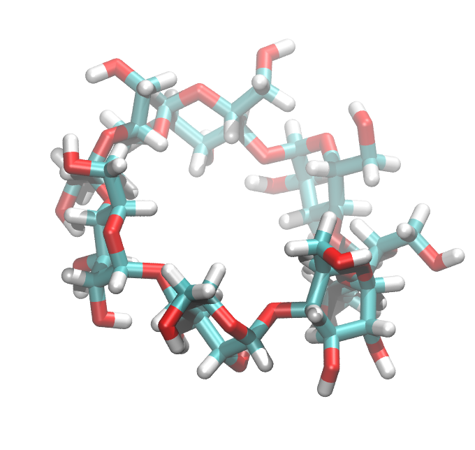
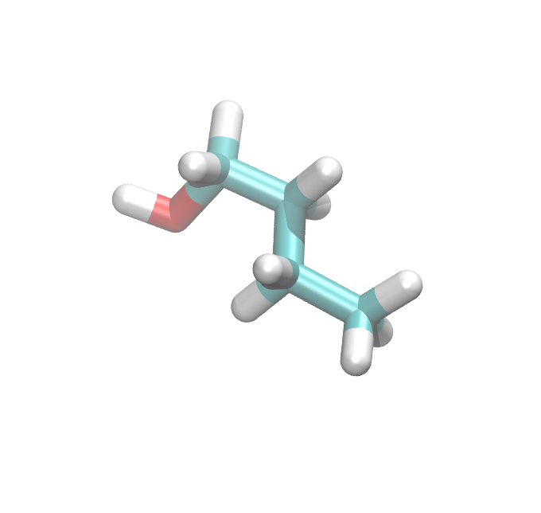
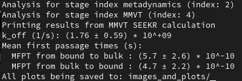
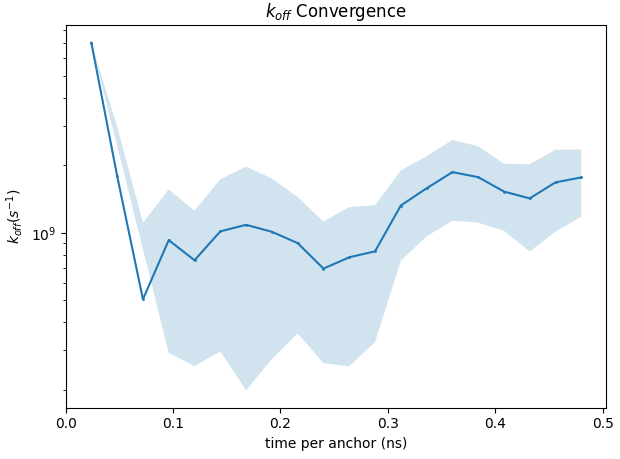
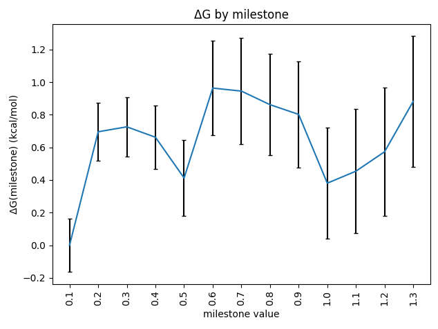

Tutorial 1: Host-guest calculation (MD-only)
============================================

In this tutorial, we will be performing a typical seekr calculation to determine
the kinetics of binding between beta-cyclodextrin (the "host") and the small
molecule 1-butanol (the "guest").

   
   The beta-cyclodextrin "host" molecule

   
   The 1-butanol "guest" molecule

Navigate to the location where the seekr/ Git repository was cloned, and enter
the repository's program directory and view the available programs::

  cd seekr/seekr
  ls

You should see a number of python programs, as well as a few directories. The
first program we will be using is the "prepare.py" script.

The prepare.py script requires a "model input" file, which is in JSON format.
Using Gedit, Pluma, Vim, or another editor, open up the file 
"data/hostguest_sample_input.json", which is a sample model input file.

There is a lot of information in here, the details of which are described in
the :doc:`Model Input Files<model_input_files>` documentation. For this 
tutorial, we will be using this file as-is, for now.

There are other provided files we need for this SEEKR2 calculation, they are 
described here:

* **data/hostguest_files/hostguest.parm7** - The AMBER parameter/topology file 
  which contains parameters for the host and guest molecules, as well as the
  water molecules comprising the waterbox.
  
* **data/hostguest_files/hostguest_at###.pdb** - Each of these files describe 
  the starting atomic coordinates and box vectors for each of the anchors in the
  MD stage. These PDB files were made using an SMD simulation, where the "guest"
  was pulled slowly away from the bound state, and the structures were saved
  as the guest molecule reached each of the anchor locations.
  
* **hostguest_receptor.pqr** - The host molecule (beta-cyclodextrin) for
  Browndye input in PQR format.
   
* **hostguest_ligand.pqr** - The guest molecule (1-butanol) for
  Browndye input in PQR format.
   
If you want to use seekr on a system of your own choosing, you will need to
generate similar input files for it, although you will not necessary need
one structure per anchor - we can sample starting structure per each anchor
using Metadynamics, Steered MD, or other enhanced sampling methods.

Next, run prepare.py on the model input file::

  python prepare.py data/hostguest_sample_input.json

For a few minutes, the script will construct a directory and file tree located
at "~/test_seekr/". The program may throw a few warnings, but these can 
usually be safely ignored, as long as there are no errors or check failures.

When the command is complete, enter the new directory and see what is there::

  cd ~/test_seekr/
  ls

You'll see a number of directories starting with "anchor_sets", as well as 
"collective_variable_sets", "images_and_plots" (if you already ran the analyze.py 
command), "logs", "selection_sets", and "unpartitioned_scope". Let's talk about 
each of thesefiles/directories. (Consider viewing the contents of the files and 
directories as we talk about them).

* **model.json** - This is arguably the most important file. It contains most of
  the high-level information used by seekr stages and analysis.
  
* **anchor_sets/** - This directory contains information about sets of "anchors" -
  ways to partition conformational space into discrete regions. There will usually
  be a "main" anchor set, and it's possible for later stages to construct new
  anchor sets based on the results of previous stages. Each anchor within a set
  contains information about the space that it encompasses, as well as information
  about individual stages that have a "partitioned" scope - that is, stages that
  are only allowed to run within the space of a single anchor.

* **collective_variable_sets/** - This directory contains information about sets of
  "collective variables" - ways to describe conformational space in a continuous
  manner. There will usually be a "main" collective variable set, and it's possible
  for later stages to construct new collective variable sets based on the results
  of previous stages. Each collective variable contains information about the function
  that defines it, as well as the selections of atoms that are used to compute it.

* **logs/** - This directory contains the log files for the various stages of the
  calculation. These log files are useful for debugging and troubleshooting. When
  remote jobs are run via **seekrflow**, the SLURM/PBS job files will be deposited
  here.

* **selection_sets/** - This directory contains information about sets of "selections" -
  ways to select atoms from the system. There will usually be a "main" selection set, 
  which is used by the "main" anchor set and "main" collective variable set to
  be defined. It's possible for later stages to construct new selection sets based on 
  the results of previous stages.

* **unpartitioned_scope/** - This directory contains information about the "unpartitioned"
  stages, which are stages that are not run within particular anchors, or partitions of 
  conformational space. These stages may still use a particular collective variable set 
  or selection set for restraints, reporters, etc.

The preparation stage is complete. Next, we complete the run stage. We will use the 
run.py program, and we will use the new model.json file as the INPUT FILE argument,
as well as the index of the stage to run::

  python run.py ~/test_seekr/model.json 1
  python run.py ~/test_seekr/model.json 2
  python run.py ~/test_seekr/model.json 3
  python run.py ~/test_seekr/model.json 4

Note that seekr periodically creates checkpoints, so if your calculation 
is ever interrupted, the run.py program can just pick right up where it left 
off. This can be very useful if running seekr on a supercomputer with a queue 
for jobs that run only a limited time.

Since this is the first time you're running this calculation, there are no
simulations yet complete, so seekr will run all the needed MD simulations. These are 
likely to take the better part of an hour if you have a relatively fast GPU running 
OpenMM. (Warning: Without a GPU, this calculation will probably take a prohibitively 
long time).

Before, during, or after running the stages, one may view the progress of the 
calculation with the status.py program::

  python status.py ~/test_seekr/model.json

This will show the progress of the calculation, including the number of transitions
observed for the MD simulations.

Next, let us perform the analysis stage. To analyze our results, we use the analyze.py 
program::

  python analyze.py ~/test_seekr/model.json
  
After a few minutes, the script should display kinetic and thermodynamic 
results (your results will be different due to the stochastic nature of
simulations):

   
   The script analyze.py outputs the dissociation rate constant (k-off).
   
in addition, we may look at some generated images and plots::

  cd ~/test_seekr/images_and_plots
  
Now use EOG or another visualization program to view some of the images::

  eog k_off_convergence.png
  

   
   Convergence plots can give hints about whether more sampling is needed.

Next, take a look at the free energy profile across the milestones(potential 
of mean force)::

  eog free_energy_profile_milestones.png
  

   
   The free energy profile (or potential of mean force) across milestones.

.. note::

    all of these results were generated using far too little sampling for a
    true seekr calculation, and simulations were cut very short here for 
    demonstration purposes, so that a seekr calculation could be completed within
    the span of an hour on a desktop computer with a GPU. The results 
    generated in this tutorial should not be taken seriously.

Congratulations! If you've made it to this point successfully, you've completed
a seekr calculation.