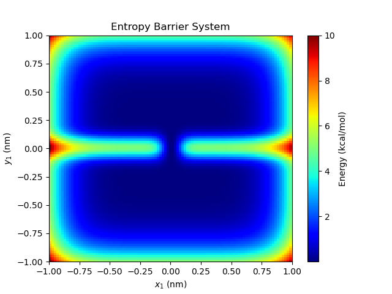
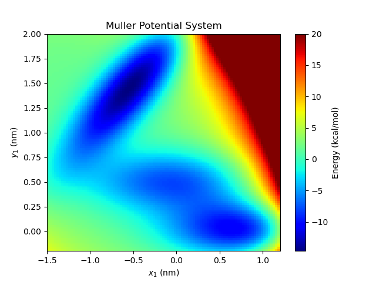

Tutorial 2: Toy Systems
=======================

In this tutorial, we will be performing seekr calculations on some "toy systems",
that is - systems with one or few particle(s) that move on relatively simple
potential energy surfaces.

Toy systems can be very useful to benchmark the accuracy of a new method,
to improve conceptual understanding of the interaction between a method and
a real molecular system, or as a teaching tool about a method.

In this tutorial, we will be using the Entropy Barrier and Muller Potential
toy systems.

   
   The Entropy Barrier toy system

   
   The Muller Potential toy system

Entropy Barrier Toy System
--------------------------

First, to prepare and run the toy systems, it will be helpful to have a
sample input JSON. Let's start by looking at the Entropy Barrier system 
input. Using Gedit, Vim, or another editor, open up the file 
"toy_entropy_barrier_input.json".

As with the host/guest system, this input file contains all the information
to prepare a seekr calculation. Detailed information for all inputs can be
found in :doc:`Model Input Files<model_input_files>` and some should be
familiar from :doc:`Tutorial 1<tutorial1_hostguest>`.

At the very beginning of the Model Input file, one can find the "toy_settings_input"
section. Inside are a number of other settings for the toy system.
  
"potential_energy_expression"
  Define the function of particle positions that describe the potential
  energy surface.

"num_particles"
  The total number of particles in this toy system.
  
"masses"
  A list of masses by particle (in units of AMU).

In addition, within the "engine_settings_list", type="openmm", "unpartitioned_settings",
there is a "positions" list, which contains the initial positions of the particles for 
all of the stages.

Lastly, the "partitions" section contains three key inputs:

"cvs"
  There's a single collective variable called "progress_coordinate", which is
  defined as the y-coordinate of the particle, and has a minimum value of -1.0
  and a maximum value of 1.0.

"state_points"
  A list of state points, which approximately represent the bottoms of the
  wells of the two-well potential.

"anchor_scheme"
  The anchor scheme is used to define the anchor locations using a Voronoi tessellation
  of the collective variable space. Within each Voronoi cell, the "value" field
  is used to define the anchor location, while the "positions" field contains the
  positions of the particles in the system at the anchor location.

.. note::
    In general, it's a good idea to use the CPU to run toy systems instead of the
    GPU. In the input file, this is accomplished by using "platform_type" set to 
    "reference".

We are ready to run prepare.py on the model input file, run, and analyze.::

  cd ~/seekr/seekr
  python prepare.py data/toy_entropy_barrier_input.json
  python run.py ~/test_seekr_toy_entropy_barrier/model.json 1
  python analyze.py ~/test_seekr_toy_entropy_barrier/model.json
  
All of these commands should work the same for the toy system as they did
for the molecular host/guest system.

One final step involves visualizing the trajectories in the toy system.
The seekr/seekr/tools contains a script for visualizing the 
results of the toy systems.::
  
  python tools/toy_plotting.py ~/test_seekr_toy_entropy_barrier/model.json 1
  
A video should appear that shows the trajectories moving around the Voronoi
cells of the Entropy Barrier system. 

Muller Potential Toy System
---------------------------

Let us perform a similar calculation using the Muller potential. This time,
instead of just providing the positions of the particles at the anchor locations,
we are going to use metadynamics to sample the anchor starting positions.

The model input file for the Muller potential can be found in
seekr/seekr/data/toy_muller_potential_input.json. Using Vim, Gedit, or another text
editor, open the file "toy_muller_potential_input.json". There are a few
key differences between the Muller potential and the Entropy Barrier system.

"potential_energy_expression"
  There is a new potential energy expression for the Muller potential.
  
the "partitions" section contains three key inputs:

"cvs"
  This time there are two collective variables, "x_coordinate" and "y_coordinate".

"state_points"
  There are two state points, one for each of the low wells in the Muller potential.

"anchor_scheme"
  This anchor scheme now has lists of size 2 for the "value" entries, one for 
  each of the collective variables. The "positions" field is set to an empty string,
  since the positions for each anchor will be found using metadynamics.

.. note::

    In stage 1, "metadynamics", the "position" reporter has an interval of 5,
    this was just for visualization purposes when we eventually generate a video.
    This is a very low interval for simulations, and you should consider increasing
    this value for your own simulations so that you don't fill your hard drive with
    stage's trajectory files.

We will perform the same steps as before.::
  
  cd ~/seekr/seekr
  python prepare.py data/toy_muller_potential_input.json
  python run.py ~/test_seekr_toy_muller_potential/model.json 1
  python run.py ~/test_seekr_toy_muller_potential/model.json 2
  python run.py ~/test_seekr_toy_muller_potential/model.json 3
  python analyze.py ~/test_seekr_toy_muller_potential/model.json

One may also make a video of the simulations in the Muller 
potential by using the tools/toy_plotting.py program.::
  
  python tools/toy_plotting.py ~/test_seekr_toy_muller_potential/model.json 1 -S 10
  python tools/toy_plotting.py ~/test_seekr_toy_muller_potential/model.json 3

